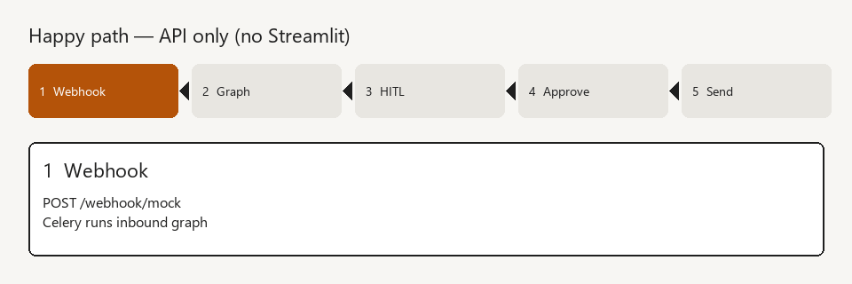
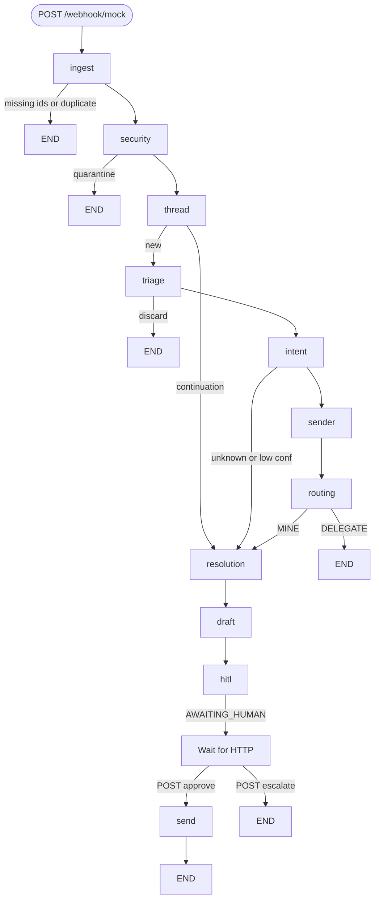

# p2p-ai-langraph

**LangGraph AP email assistant — HTTP operators, no Streamlit.**

## The problem this solves

Before this, answering a supplier's invoice query meant VPN in, wait for the SAP session, hope it didn't time out, search one vendor account at a time, find the document, write the reply. On average that was about 1h 15m of actual work per day. Now it's closer to 20 minutes (rough estimate) — the system reads the email, finds the invoice, and has a draft ready. I just review and send.

The questions repeat, but the answers depend on state that lives in different places for different vendors:

- "Has this been paid?": sometimes yes with a clearing document attached, sometimes SAP says paid but clearing hasn't posted yet — those two cases need different answers, not the same one
- "Why is this stuck?": could be sitting in approval past its due date, or blocked at the posted stage waiting on payments
- "When will this go out?": future timing, usually needs the approval owner, not the supplier, to answer

Edge cases still take real time -> VAT mismatches, invoices that show up in two different SAP tables, duplications, references that don't match cleanly because of OCR noise on scanned attachments. There's room to automate more of those, but for now they go to a human.

The real pain was the fragmentation. Every vendor lived in its own silo. This centralizes everything: inbound email, invoice lookup, draft, approval, audit trail — one place.

Nothing goes out automatically. A person still approves every reply.

Inbound supplier mail is classified, matched against mock SAP, drafted, and parked for a human. Send runs only after `POST /tickets/{id}/approve`.

> Park at HITL. Never auto-send.

<div align="center">


</div>

---

## What it is

A procure-to-pay AP assistant built with **native LangGraph**. The graph, domain, and ports do not import Postgres, Redis, or an LLM vendor — adapters swap (memory in tests, Postgres in the worker).

Operators sign in to the React console in `frontend/`, or call the API with the session cookie. Operator UI: [frontend/README.md](frontend/README.md).

---

## Happy path

Webhook → inbound graph → `AWAITING_HUMAN` → approve → mock send.

<div align="center">



</div>

| Step | What happens |
|---|---|
| `POST /webhook/mock` | Celery runs the **inbound** graph only |
| HITL | Ticket status `awaiting_human`; draft stored if the decision table allows |
| `POST /tickets/{id}/approve` | Session operator; `HitlService` runs the send node (not on the inbound spine) |
| Escalate | Same session; status `escalated`, no send |

Resolution can retry **once** with wider match tolerances when `RESOLUTION_RETRY_ENABLED=true`. Default is **off** so golden eval stays comparable to the original assistant.

---

## Core behaviour

- **Security** — sender-domain whitelist; optional SPF/DKIM
- **Triage / intent** — AP vs discard; payment status, delay reason, future timing (LLM behind `LLMPort`)
- **Routing** — MINE vs DELEGATE from sender directory rules
- **Resolution** — exact ref → fuzzy ≥ 0.85 → amount ± tolerance + supplier; VAT notes; PAID without clearing → HITL
- **Draft** — deterministic target (sender / invoicing / payments / approval owners). The prompt carries the matched invoice (amount, stage, due date, clearing, payment date, blocking reason). The model writes `generated_text` only, and may say the invoice is paid only when a clearing document exists.
- **HITL API** — list/get tickets, draft, approve, escalate, stats. These routes need a session. Approve and escalate record that operator. 409 if the ticket is not awaiting a human. Ticket detail audit rows include `confidence` and `created_at`.
- **Auth** — operators live in Postgres (`operators`, `operator_sessions`). Passwords are Argon2. The cookie is `HttpOnly` and holds a random token; Postgres stores only its SHA-256. Auth is not a workflow port: the graph never sees who is logged in. `/health`, `/ingest`, and `/webhook/mock` stay public.

Early exits: missing ids, duplicate, quarantine, discard, delegate.

---

## 🧠 Technical highlights

### Key technical decisions

- **Deterministic + LLM hybrid** — invoice matching and draft target selection are pure rules; triage, intent classification, VAT reasoning, and draft text are structured LLM calls. The system knows what it can decide without a model.
- **Hexagonal architecture** — 7 ports (Email, Tickets, LLM, SAP, Audit, Senders, Drafts) with adapters that swap cleanly. `WorkflowDeps` is closed in node factories, never put in graph state.
- **Graph-native orchestration** — LangGraph `StateGraph` with conditional edges; inbound ends at HITL. Approve runs `make_send_node` outside the inbound spine (option 2 — no checkpointer needed).
- **Eval harness** — 20 golden fixture emails, `FixtureGuidedLLM`, full `ainvoke`; exits 1 if success rate < 0.80.

### Architecture highlights

- **Inbound spine**: FastAPI → Celery → LangGraph nodes → `AWAITING_HUMAN`
- **Approval path**: HTTP `POST /approve` → `HitlService` → send node (mock)
- **Storage**: Postgres for tickets, audit, drafts, operators, and sessions; JSON fixtures for SAP and the sender directory
- **Isolation**: in-memory adapters in tests and eval — no Docker needed to run the graph

## ⚙️ Stack

### API & worker

| Layer | Tech |
|---|---|
| Graph | LangGraph |
| API | FastAPI (`/webhook/mock`, `/tickets`, approve/escalate, `/auth` cookie sessions with Argon2 passwords) |
| Queue | Celery + Redis (Windows: `--pool=solo`) |
| Store | Postgres via Alembic migrations |

### Adapters (current)

| Port | Implementation |
|---|---|
| Email | `MockEmailAdapter` — parses raw webhook dict |
| SAP | `MockSAPAdapter` — reads `fixtures/sap_mock/*.json` |
| Senders | `MockSenderDirectory` — reads `fixtures/senders/*.json` |
| LLM | `OpenAILLMAdapter` (structured outputs, one retry, optional fallback) when `LLM_PRIMARY_API_KEY` is set; otherwise `MockLLMAdapter`, which always returns AP + `INV-2026-0001`. Eval uses `FixtureGuidedLLM`. |
| Tickets / Audit / Drafts | Postgres repos (swap to in-memory in tests) |

### Operator UI

| Layer | Tech |
|---|---|
| Framework | Vite 6 + React + TypeScript |
| UI | shadcn/ui (Radix, Tailwind 4): status tiles, ticket feed, tabbed detail, review dialog, toasts |
| Auth | `/login`, cookie session, route guard. The header shows the signed-in operator. |
| State | REST polling (no websockets) |
| Port | 5173 (API on 8000). Use `localhost` on both, or the cookie is not sent. |

**Not yet implemented:** live SAP connector, real email send (Nylas), OCR on attachments, multi-tenant auth.

---

## Workflow

If SAP says paid and there's no clearing document, we still don't tell the supplier it's paid. That ticket waits for a human.



Retry logic stays inside `resolution` — no extra graph nodes.

There's still a lot to do. Live SAP, real email sending, OCR for attachments, multi-operator routing at scale — this is a working proof of concept, not a finished product.

---

## Run

Postgres **5434**, Redis **6380**. From this directory:

```powershell
docker compose up -d
copy .env.dev .env
alembic upgrade head
python scripts/seed_operator.py --id op_joao --email joao@company.com --name "João"
```

Fix `DATABASE_URL` in `.env` to `lab:lab_dev` if compose uses those credentials. The seed script prompts for the operator password.

**1 — API**

```powershell
uvicorn app.api.main:app --reload --port 8000
```

**2 — Worker (Windows)**

```powershell
celery -A app.worker.tasks:celery_app worker --pool=solo --loglevel=info
```

**3 — Ingest** (whitelisted `acme-supplies.com`). Without `LLM_PRIMARY_API_KEY`, triage and intent stay fixed on AP + `INV-2026-0001`. With a key, the email text drives those calls. Restart the worker after changing the key.

```powershell
curl -s -X POST http://127.0.0.1:8000/webhook/mock -H "Content-Type: application/json" -d "{\"thread_id\":\"t1\",\"message_id\":\"msg-demo-1\",\"from\":\"billing@acme-supplies.com\",\"subject\":\"Invoice INV-2026-0001\",\"body\":\"Please confirm payment status\"}"
```

If Redis is down, the same POST runs the graph in-process and returns `{ "ticket_id", "status" }`.

Ticket and HITL routes need an operator session (an `HttpOnly` cookie). Log in once and reuse the cookie jar. Use `localhost` throughout, because the cookie is tied to the host name:

```powershell
curl -s http://localhost:8000/health
curl -s -c cookies.txt -X POST http://localhost:8000/auth/login -H "Content-Type: application/json" -d "{\"email\":\"joao@company.com\",\"password\":\"<your password>\"}"
curl -s -b cookies.txt http://localhost:8000/tickets/<ticket-uuid>
curl -s -b cookies.txt -X POST http://localhost:8000/tickets/<ticket-uuid>/approve -H "Content-Type: application/json" -d "{}"
```

The approver recorded on the review is the logged-in operator, not a field in the request.

Unknown domain (`evil.example`) → `quarantined`. High-confidence non-AP → `discarded`. Other operator → `delegated`.

**4 — Operator UI** (API on port 8000)

```powershell
cd frontend
npm install
npm run dev
```

Open `http://localhost:5173` and sign in with the seeded operator. Copy `frontend/.env.example` to `frontend/.env` if `VITE_API_URL` is not already `http://localhost:8000`. This app is pinned to Vite 6 so it runs on Node 20.18. oxlint is pinned to 1.16 for that same Node version.

**Eval** (in-memory, fixture-guided LLM, retry off):

```powershell
python scripts/run_eval.py
```

Writes `golden_dataset/baselines/v1.json`.

---

## Why LangGraph, and what I took from it

This is the second version of this system. The first was built on the [Launchpad](https://launchpad.datalumina.com/docs/welcome/introduction) workflow engine (linear nodes, manual routing). It worked, but I wanted to understand what a graph-native orchestration framework actually buys you versus rolling your own, and also, I never had made a hands-on project with langraph

The honest answer: less than I expected for a linear pipeline like this one. LangGraph's real advantage shows up with cycles and conditional branching that loop back and the retry logic in `resolution` is the one place here that actually benefits from that. For the rest, it's mostly a different way of writing the same routing decisions.

What building this twice reinforced, more than the framework choice, is that agent orchestration is downstream of good data modelling. The routing logic only works because the domain models (Ticket, Invoice, Sender, AuditEntry) and the ports around them were designed first, the graph is just the thing that walks through decisions that data structure already made possible. Get the data model wrong and no orchestration framework fixes that.
