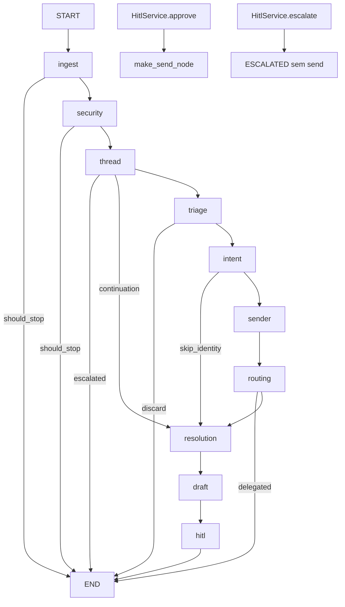

# Auditoria do workflow

Data: 2026-10-13. Âmbito: ingresso, grafo inbound, persistência, HITL e envio. Nenhum node foi alterado. As recomendações são só classificação; não mudam a lógica de decisão.

O desenho está certo para o laboratório. Factories fecham `WorkflowDeps`, o estado serializa sem ports, o matching e o destinatário são funções puras, e o envio fica fora do `StateGraph`. Os problemas estão na concorrência, na ordem não garantida de “último draft”, em scans lineares e em fronteiras que saltam os ports. Não justificam reescrever os nodes.

Último golden loop conhecido: sucesso 0,97 (29/30). O `022` falha de propósito porque cada fixture abre uma store vazia.

## Invariantes que não se mexem

| ID | Contrato | Onde |
|----|----------|------|
| I-01 | O grafo inbound acaba em `hitl`. Não há checkpointer. Approve corre `make_send_node` fora do grafo. Escalate não envia. | `app/graph/app.py:1-7`, `app/api/hitl.py:1-2` |
| I-02 | `WorkflowDeps` não entra em `LabState`. | `app/graph/state.py:1-3` |
| I-03 | `should_stop` manda o router para `END`, excepto os saltos explícitos de thread, intent e routing. | `app/graph/app.py:30-58` |
| I-04 | Continuação de thread troca `ticket_id` para o ticket anterior e salta triage/intent. | `app/graph/nodes/thread.py:67-92` |
| I-05 | Intent desconhecido ou confiança ajustada `< 0.5` salta sender e routing. | `app/graph/nodes/intent.py:52-66` |
| I-06 | Routing para operador diferente do default pára em `delegated` e não resolve. | `app/graph/nodes/routing.py:46-57` |
| I-07 | Ladder: exact, depois fuzzy, depois amount+supplier. Exact em approval e posted é `MULTIPLE`. | `app/graph/match.py:67-104` |
| I-08 | `extraction_confidence < 0.5` ignora ref e amount. Omissão da chave vale `1.0`. | `app/graph/nodes/resolution.py:45-48` |
| I-09 | `pick_target` é determinístico. O LLM só escreve o texto. | `app/graph/nodes/draft.py:19-64` |
| I-10 | Sem `eval_date`, `due_flags` usa `date.today()`. O eval injeta a data de `received_at`. | `app/graph/match.py:107-110`, `app/graph/nodes/resolution.py:25-34` |
| I-11 | HITL fica sempre `awaiting_human`, mesmo sem draft. Prazo: dia de vencimento às 00:00 UTC, ou agora + 24 h. | `app/graph/nodes/hitl.py:12-40` |
| I-12 | Envio falhado não resolve. Flag desligada resolve em mock, sem HTTP. | `app/graph/nodes/send.py:46-117` |
| I-13 | Dedup: primeiro `message_id`, depois hash `from\|subject\|body[:300]` em 16 hex. | `app/graph/nodes/ingest.py:12-62` |
| I-14 | `CONFIDENCE_THRESHOLD` (0.7) não dispara envio. Está declarado e não é lido. | `settings.py:17` |

Estados terminais do inbound: `quarantined`, `discarded`, `delegated`, `escalated_thread`, `awaiting_human`, `missing_ids`, `duplicate`, `missing_ticket`. `resolved` só nasce no send.

## Fluxo real

Padrões que estão bem aplicados: Factory (`make_*_node`), Adapter/Port (sete ports em `WorkflowDeps`), Strategy implícita nos routers, e algoritmo puro em `match_invoices` / `pick_target`. Não há Repository dentro dos nodes; eles falam com ports.

## Achados

Prioridade para o laboratório actual (um worker). Com vários workers, A-01 sobe a bloqueante.

| ID | Classe | Pri | Evidência | Impacto | Mudança segura |
|----|--------|-----|-----------|---------|----------------|
| A-01 | risco | P1 | `ingest.py:39-76`; unique em `db_models.py:21` | Dois workers podem passar o `get` e o segundo rebenta com `IntegrityError` em vez de parar como `duplicate`. | Apanhar a violação da unique e devolver o mesmo `stop_reason=duplicate`. Não mudar a ordem message_id depois hash. |
| A-02 | risco | P1 | `postgres_repos.py:73-76` e `32-35`; consumidores `drafts[-1]` em `send.py:26`, `app/api/hitl.py:54`, `tickets.py:15` | `SELECT` sem `ORDER BY`. “Último draft” e a ordem do audit não estão definidos quando há mais do que uma linha. | `ORDER BY created_at ASC` nos dois repos e no store em memória. O `[-1]` mantém-se. |
| A-03 | risco | P1 | `main.py:40-45` | `except Exception` trata Redis em baixo e um bug de serialização da mesma forma: corre o grafo dentro do pedido HTTP. | Apanhar só erros de broker. O fallback síncrono fica. |
| A-04 | risco | P1 | `postgres_tickets.py:105-108`, `postgres_repos.py:29` e `:70` | Cada `save`/`append` faz commit. Uma falha a meio deixa ticket e audit parciais. | Introduzir uma unidade de trabalho por execução, com os mesmos writes. Não fundir decisões dos nodes num único update. |
| A-05 | risco | P2 | `postgres_tickets.py:81-85`; índice não único em `f3a91c2e8b40_ticket_content_hash.py:26` | Hash de 64 bits, `.first()` sem ordem. Colisão ou duplicado legado devolve uma linha arbitrária. | Ordenar por `created_at` e documentar que a unique não existe de propósito (hashes legítimos repetidos são o caso de dedup, não de constraint). |
| A-06 | melhoria | P2 | `postgres_tickets.py:110-123` | `count_by_status` lê todas as linhas. `count_hitl_overdue` lê todos os `awaiting_human` apesar do índice em `hitl_deadline`. | `GROUP BY` e `COUNT(*) ... WHERE hitl_deadline < now`. Mesmos números. |
| A-07 | melhoria | P2 | `tickets.py:23-27` | Cada detalhe percorre as duas listas SAP. | Índice em memória por `invoice_ref` dentro do adapter, construído uma vez por processo. A procura continua exacta. |
| A-08 | melhoria | P2 | `match.py:63-89` | Exact e fuzzy percorrem o pool. `SequenceMatcher` é quadrático no comprimento da ref. No mock isto é irrelevante. | `dict[str, list[Invoice]]` pela ref normalizada para o ramo exact. O ramo fuzzy mantém o varrimento e os mesmos limiares. |
| A-09 | risco | P2 | `memory_ticket_store.py:40-49` vs `postgres_tickets.py:102` | A lista em memória não ordena por `updated_at desc`. Testes não vêem o contrato da UI. | Ordenar a memória como o Postgres. |
| A-10 | risco | P2 | `match.py:110` | Sem `eval_date`, “hoje” é a data local do processo, não UTC. À volta da meia-noite o overdue pode divergir do prazo HITL, que é UTC. | Passar um relógio injectável com default explícito. Fora do eval, o default actual mantém-se até haver decisão de produto. |
| A-11 | melhoria | P2 | `send.py:5`; `tasks.py:16`; `deps.py:55-63` | O node de send importa o adapter Nylas. O worker importa o composition root da API. SAP, senders e email são sempre mock. | `SendPort` e um composition root único. As chamadas e os payloads ficam iguais. |
| A-12 | melhoria | P2 | `db_models.py:39-79` | `senders`, `routing_rules` e `invoice_cache` têm tabela e não têm adapter. O runtime usa JSON. | Decisão explícita: seed Postgres ou tabelas marcadas como reserva. Não ligar as tabelas sem teste de paridade. |
| A-13 | gap de teste | P1 | `eval_harness.py` store nova por fixture; `022_content_duplicate_resubmit.json` | O golden não prova dedup nem continuação. O `022` baixa o score de propósito. | Deixar assim. A prova é `tests/test_node_ingest.py` e `tests/test_node_thread.py`. |
| A-14 | gap de teste | P2 | sem teste de `IntegrityError`, Celery real, `TOO_MANY`, nem contract test memória/Postgres | Regressões de A-01, A-02 e A-09 passam despercebidas. | Testes novos à volta dos adapters, sem editar nodes. |
| A-15 | melhoria | P3 | domínio do email em `security.py:15-18`, `sender.py:25-27`, `routing.py:17-19` | Três parsers. O adapter já faz `lower()`, por isso hoje não muda o resultado. | Um helper. Não alterar a ordem email-antes-de-domínio em `get_routing_rule`. |
| A-16 | melhoria | P3 | `app/api/hitl.py:14-15` e `send.py:14-15`; `settings.py:17`; penalty `0.2` em `security.py:70-75`; gate `0.5` em `resolution.py:46` | Protocol duplicado, setting morto, dois limiares fora de `Settings`. | Unificar o protocol. Não apagar `CONFIDENCE_THRESHOLD` sem confirmar que nenhum deploy o lê. Não mover o `0.5` sem o deixar como default. |

Não há P0 no modo actual: um worker `--pool=solo` e o mock SAP. A-01 e A-02 são os primeiros a tratar antes de mais do que um consumidor.

## Núcleo do grafo

### `app/graph/state.py`

Contrato `TypedDict` com `total=False`. Quase tudo é opcional; ausência e `None` não são a mesma coisa, e os nodes usam `.get`. `audit_action`, `audit_metadata` e `audit_confidence` entram no estado porque o LangGraph faz merge do update. O wrapper lê o update do node actual (`app.py:67-68`), não o valor antigo. São campos transitórios no sítio errado, sem efeito nas decisões.

`route` é `str` livre (`resolution`, `triage`, `sender`, `routing`, `end`). Um `Literal` documenta sem mudar routers.

`invoice_dump` transporta a invoice inteira entre resolution e draft/HITL. Para uma invoice é a estrutura certa: o draft não volta a consultar o SAP e não depende de um cache.

### `app/graph/app.py`

Dez nodes. `send` não está registado (`:84-109`). `_with_audit` aceita sync e async (`:63-66`) e só grava se houver `ticket_id` e `audit_action`. `missing_ticket()` não traz nenhum dos dois, logo não há audit. Correcto para um estado impossível no caminho normal; gap se um `ticket_id` corrompido aparecer.

`_stop_or` é uma closure de Strategy. Sender não tem router condicional: o edge é fixo para routing (`:103`). Sender nunca deve parar. Se um dia parar, o router não existe e o fluxo continua. Hoje o node garante `should_stop=False` (`sender.py:38`).

### `app/graph/match.py`

Algoritmo em três passagens sobre a concatenação approval+posted:

1. Exact normalizado, O(n). Dois hits no mesmo lado: `TOO_MANY` (`:72-73`). Um em cada lado: `MULTIPLE` (`:70-71`). Um hit: `MATCH` e retorno imediato, antes da tolerância de amount.
2. Fuzzy com cutoff 0.85, O(n · custo do `SequenceMatcher`). Mais de 3 hits: `TOO_MANY`. 2 ou 3: `MULTIPLE`.
3. Amount dentro de `max(1.00, 2% · max(valores))` e supplier por substring ou fuzzy ≥ 0.8.

Não há índice. Com dezenas de invoices do fixture, o custo é ruído. A estrutura que preserva o resultado no ramo exact é um mapa de listas, não um mapa de um só valor: a detecção de `MULTIPLE` / `TOO_MANY` precisa dos duplicados.

`due_flags` é O(1). `today or date.today()` distingue “não passou data” de “passou”. `_as_of` devolve `None` quando não há `eval_date`, e esse `None` cai no relógio local. Ver A-10.

`widened_match_settings` usa `model_copy` (`:160`). Não muta o settings original. Coberto por `test_widened_settings_do_not_mutate_original`.

### `app/graph/nodes/_ticket.py`

`load_ticket` faz `UUID(raw_id)` (`:15`). Um id mal formado levanta `ValueError` em vez de `missing_ticket`. Não há teste. No fluxo real o id nasce em `str(saved.id)`.

### `app/graph/nodes/ingest.py`

Check-then-act, não insert idempotente. Ordem correcta: ids, message_id, content hash, insert. O hash é SHA-256 truncado a 16 hex (`:12-15`). Memória e Postgres fazem a procura por varrimento linear ou por índice não único. A unique de `message_id` é a rede real e não está traduzida para o `stop_reason` (A-01).

### `app/graph/nodes/security.py`

Whitelist compilada em `set` por chamada, O(domínios). Devia ser um set no arranque; o CSV é pequeno. SPF/DKIM: os dois falham ou ausentes quarentenam; um falha aplica penalty 0.2 fixo e segue. Flag desligada não lê auth. O parser de domínio faz `lower()`; os outros dois sítios não, mas o directory também faz. Extrair helper é seguro (A-15).

### `app/graph/nodes/thread.py`

`list_by_thread_id` devolve o conjunto; o node ordena por `updated_at` desc em Python (`:39`). Precedência: escalated, depois open/awaiting, depois resolved. Empate de timestamp fica à mercê da ordem instável do SQL, porque o sort do Python é estável e a entrada não tem ordem. Empate real é raro. `ORDER BY updated_at DESC, id` no port, e o mesmo no node, fecha o empate sem mudar o caso comum.

Truncagem: janela final de `THREAD_MAX_HISTORY_CHARS` (2000), a cortar num separador se existir (`:14-24`). É o algoritmo certo para “ficar com o fim”; não é um resumo.

Dois saves por continuação (prior e actual). Com commit por save, o primeiro pode persistir e o segundo falhar (A-04).

### `app/graph/nodes/triage.py`, `intent.py`, `sender.py`, `routing.py`

Triage e intent são I/O (LLM) mais um predicado. O predicado de triage é `not is_ap and confidence >= 0.8` (`triage.py:35-39`). Abaixo disso, não-AP continua. Intent subtrai a penalty e compara com `<`, não `<=` (`intent.py:52-56`).

Sender é uma escada 0.9 / 0.6 / 0.0 e nunca pára. `sender_id` fica no state e no audit, não no `Ticket`. Routing: regra por email, senão domínio (`mock_sender_directory.py:51-67`). Sem regra, `hitl` deixa o operador vazio e segue; `default` atribui `DEFAULT_OPERATOR_ID`. Outro operador delega e pára.

`IntentOutput` vive no node; `TriageOutput` vive em `schemas.py`. A assimetria não afecta o grafo. Mover o modelo é cosmético.

Não há testes unitários dedicados a `intent.py` nem `sender.py`. O caminho está coberto por `tests/test_day4.py` através do grafo.

### `app/graph/nodes/resolution.py`

Orquestra: gate de extracção, hint de supplier, match, no máximo um retry, VAT condicional, paid sem clearing, due flags, dump. O retry está desligado por default (`settings.py:23`) e o eval força-o desligado. A lógica do retry está testada em `tests/test_node_resolution_retry.py`.

O gate `0.5` não é `INTENT_MIN_CONFIDENCE`, embora o número coincida (A-16). VAT só corre depois de `MATCH` e quando o amount extraído fecha com o gross e não com o net (`match.py:117-130`).

`save_ticket` no fim só actualiza `updated_at`. O resultado do match não é coluna do ticket; vai para o state e para o audit. A UI recupera a ref pelo audit `RESOLVE` (`tickets.py:17-21`). Se esse audit faltar, o detalhe perde a invoice mesmo com dump no state. O state não sobrevive ao processo. É o desenho actual, não um bug de node.

### `app/graph/nodes/draft.py`

`pick_target` é uma tabela de decisão, não um algoritmo de procura. Os ramos que devolvem `None` (múltiplos, VAT, overdue sem owner, paid sem clearing) saltam o LLM (`:97-106`). `attach_payment_proof` só é verdadeiro com paid e clearing (`:124-128`). `_to_email` é um lookup por enum. Reescrever a tabela como dados não compra clareza e arrisca a ordem dos `if`. Deixar a função.

### `app/graph/nodes/hitl.py` e `send.py`

HITL sempre pára, mesmo com edge fixo para `END`. O `should_stop` é redundante e deve manter-se: é o que o eval e os routers entendem.

Send não usa `_with_audit`; grava `AuditEntry` à mão e importa `send_reply`. A review (`send.py:92-100`) grava-se no ramo mock, sem HTTP, e depois de um `messages/send` com sucesso. Falha (sem credenciais ou `OSError`) deixa `awaiting_human` e não grava review. O status HTTP do Nylas, quando existe, fica em `metadata.status_code` do audit. A rota approve responde 200 com `stop_reason=send_failed`. Não responde 502. O blocking `urlopen` com timeout 10 (`nylas_send.py:36`) está num endpoint síncrono, portanto não bloqueia um event loop partilhado. O timeout não vem de settings.

`ReviewStore` está duplicado. `HumanReviewRepo` não entra em `WorkflowDeps` (A-16).

## Domínio, ports, adapters

### Contratos

`WorkflowDeps` tem settings mais sete ports (`app/domain/deps.py:15-24`). Falta um port de review e um port de send. Auth está de fora, de propósito.

`TicketStorePort` não declara ordenação (`ticket_store_port.py:23-33`). Postgres ordena a listagem; a memória não. O port devia dizer “`updated_at` descendente” para `list_tickets` e deixar `list_by_thread_id` sem ordem, porque o node ordena. Hoje a diferença está escondida (A-09).

Enums são `str` e gravam-se como texto. Um rename sem migração parte a leitura (`Intent(row.intent)` e equivalentes).

### Schema

`message_id` unique. `content_hash` indexado e não unique. `hitl_deadline` indexado e a query não usa o índice como predicado (A-06). FKs de drafts, audit e reviews não têm `ON DELETE CASCADE`; sessions de operador têm. Apagar um ticket deixa órfãos ou falha na FK. Não há fluxo de delete, por isso é latente.

`Operator.password_hash` não está no modelo de domínio. A API devolve `Operator` sem hash. Correcto.

### Postgres e memória

Padrão Repository, commit por operação, sem Unit of Work (A-04). Mappers `_ticket_to_table` / `_ticket_from_table` são o único sítio de tradução. `_as_utc` está copiado nos dois stores; a cópia é pequena e evita divergência se os dois testes passarem com o mesmo caso.

`get_by_message_id` e `get_by_content_hash` em memória são O(n) sobre um dict por id. Para testes chega. Não vale um segundo índice até o contract test existir.

`InMemoryTicketStore.save_ticket` guarda a mesma referência. Mutar o objecto depois do save altera o store. Os nodes mutam e depois gravam; desde que não mutem depois, está estável.

### Mocks e LLM

`MockSAPAdapter` e `MockSenderDirectory` carregam listas e procuram em O(n). `get_by_email` e regras já normalizam caixa. `OpenAILLMAdapter` tenta, espera, tenta outra vez, e só depois cai no fallback (`openai_llm.py:53-57`). É a única retry layer de I/O do LLM. O retry de matching é outro mecanismo e está desligado.

`nylas_send.send_reply` não implementa port. Erros sobem como `OSError` / `HTTPError`. O node trata `OSError`, e `HTTPError` é subclasse, portanto 4xx/5xx não resolvem o ticket.

## Fronteiras

### `app/api/deps.py`

Composition root. Uma sessão por chamada. SAP, senders e email são fixtures mesmo com LLM real (`:55-63`). Paridade de demo, não de produção. O LLM default sem chave é uma fila de três respostas fixas (`:15-30`): triage, intent, draft. Uma quarta chamada LLM no mesmo ticket esgota a fila.

### `app/worker/tasks.py`

`process_email` não tem `autoretry`, `acks_late` nem chave de idempotência (`:50-52`). A idempotência está só no ingest, depois do parse. `asyncio.run` por tarefa encaixa no pool solo. O retorno é `{ticket_id, status}` e omite `stop_reason`. Quem consome o 202 com `task_id` não vê o estado; quem cai no fallback síncrono vê. São dois contratos no mesmo status HTTP (`main.py:53-55`).

### `app/api/main.py` e `app/api/nylas.py`

`_enqueue` é o único produtor da fila. Nylas importa-o lazy para cortar o ciclo (`nylas.py:104`). HMAC usa o body cru antes do JSON (`:106-112`). Tipo diferente de `message.created` devolve 200 sem enfileirar: o retry do Nylas não reprocessa. Isso está testado.

O webhook não preenche SPF/DKIM. Com `SPF_DKIM_ENABLED=false` não muda nada. Ligar a flag em mail Nylas quarentena tudo, porque ausência conta como falha (`security.py:52-68`).

### `app/api/hitl.py` e `app/api/tickets.py`

Approve: exige `awaiting_human`, exige draft, grava texto editado, grava audit, depois send. Escalate não chama send. 409 se o estado não for o esperado.

`ticket_detail` faz quatro leituras (sender, drafts, audit, duas listas SAP) por pedido (A-07). Não é N+1 de tickets; é um full scan do catálogo SAP por detalhe. No mock cabe. Com SAP real não cabe.

`GET /tickets/{id}/draft` também usa `drafts[-1]` (`main.py:99-102`), o mesmo contrato frágil de A-02.

Auth partilha `engine` com o worker (`main.py:20`). Uma pool, dois papéis. Aceitável no lab. Não é port do workflow.

## Verificação

| Invariante | Prova | Lacuna |
|------------|-------|--------|
| I-01 grafo sem send | leitura de `app.py`; approve em `test_hitl.py` | nenhum teste faz `assert "send" not in graph.nodes` |
| Happy path até `awaiting_human` | `test_graph.py`, `test_process_email.py` | |
| Dedup message_id e hash | `test_node_ingest.py` | corrida Postgres; golden `022` não conta |
| Quarentena e SPF | `test_node_security.py`, fixture 004/017/021 | |
| Thread e truncagem | `test_node_thread.py` | `depends_on` do 027 ignorado; o guiado já recebe a ref |
| Triage | `test_node_triage.py` | |
| Intent, skip, delegate | `test_day4.py` | sem teste só do node sender |
| Routing no_rule | `test_node_routing.py` | |
| Match e `pick_target` | `test_node_resolution.py` | `TOO_MANY` fuzzy com mais de 3 hits sem teste |
| Retry | `test_node_resolution_retry.py` | desligado no eval |
| HITL, prazo, erro Nylas no audit | `test_hitl.py` | `count_hitl_overdue` Postgres não isolado. O 502 é `metadata.status_code`, não o status da rota approve |
| Webhook HMAC | `test_nylas_webhook.py` | entrega live fora de CI |
| Golden 30 | `test_eval_suite.py` conta os ficheiros; smoke só 001 e 004 | `run_eval.py` não é gate de CI |
| Ordenação list/draft | — | A-02, A-09 |

`docs/TEST_GAPS.md` conta 30 fixtures e `test_node_routing.py`.

O harness guiado copia `is_ap`, intent, ref, amount e texto. Prova o grafo dado o `expected`. Não prova classificação, injecção, português nem qualidade de texto. Campos omitidos no `expected` não entram na pontuação; `null` explícito entra (`scripts/eval_harness.py`, `score_dimensions`).

## O que não se mexe

- Ordem dos checks em ingest, thread, match e `pick_target`.
- Chaves de `LabState` usadas por routers e pelo eval.
- Limiares em `settings.py` e o `0.5` / `0.2` enquanto não houver default idêntico num setting.
- `ticket_id` da continuação.
- `should_stop=True` no HITL.
- Encaixar send no `StateGraph` ou ligar `CONFIDENCE_THRESHOLD` a auto-envio.
- Encadear fixtures no eval só para o `022` passar.

## Sequência de PRs, sem implementar agora

1. **Ordem.** `ORDER BY created_at ASC` em drafts e audit, nos dois adapters, mais um teste com duas linhas. Fecha A-02.
2. **Paridade da lista.** Memória ordena como Postgres. Fecha A-09.
3. **Contagens.** Agregados SQL com o mesmo resultado de `Counter`. Fecha A-06.
4. **Idempotência.** `IntegrityError` de `message_id` vira `duplicate`. Teste de duas sessões. Fecha A-01 sem mudar o hash.
5. **Fila.** `_enqueue` só faz fallback em erro de broker. Fecha A-03.
6. **Índice de refs.** Mapa de listas no ramo exact de `match_invoices`, testes actuais como rede. Fecha A-08 em parte.
7. **Porta de send e composition root.** Movimento mecânico. Fecha A-11. Não mudar payloads Nylas.
8. **Contrato do port.** Documentar ordenação e o hash não único. Decidir o destino das tabelas sem adapter (A-12).

Cada PR corre `pytest` e `python scripts/run_eval.py`. O score esperado mantém-se em 0,97 enquanto o `022` estiver fora da store partilhada.
