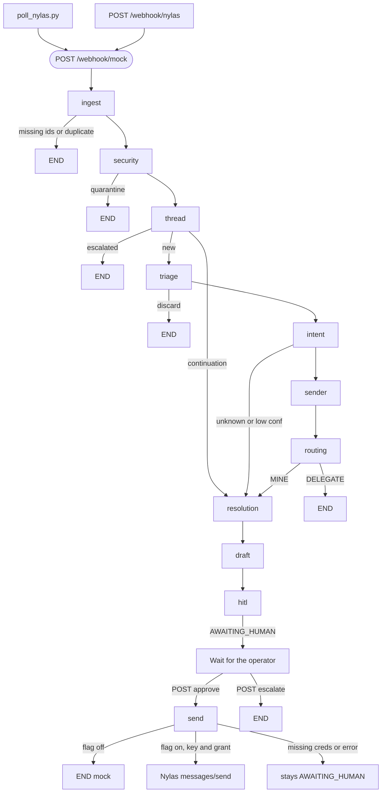
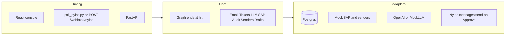
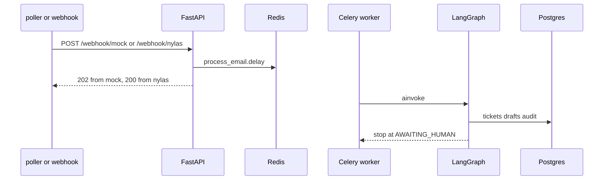
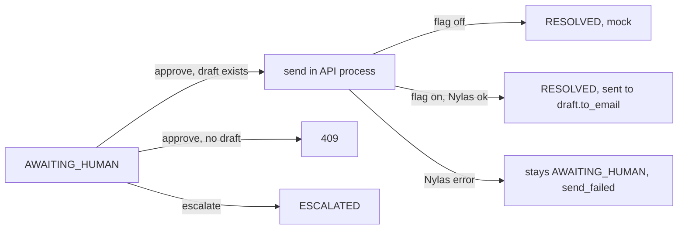

# Call diagrams

Current behaviour. The draw.io file has the same four pages.

## 1. Workflow

`poll_nylas.py` and `POST /webhook/nylas` both enter through `POST /webhook/mock`'s enqueue. The compiled graph ends at hitl. Approve and escalate are HTTP calls in the API process.

## 2. Architecture

Seven ports. Auth is not one of them. Nylas send is a direct call from the send node when the flag, key, and grant are set.

## 3. Ticket queue

FastAPI only enqueues. Celery runs `ainvoke`. Approve does not go through Redis.

If Redis is down, the same POST runs the graph in the API process and returns `ticket_id` and `status`.

## 4. Outcomes

What each email gets. Early stops never reach SAP. Everything that reaches `draft` ends at `AWAITING_HUMAN`; the draft target comes from `pick_target` in `app/graph/nodes/draft.py`, not from the LLM.

### Early stops

| Where | Condition | Result |
|---|---|---|
| ingest | missing `thread_id` or `message_id` | no ticket, no audit row. The worker return drops `stop_reason` |
| ingest | same `message_id` again | old ticket unchanged |
| ingest | same sender, subject, and first 300 characters of the body | `duplicate`, audit reason `content_duplicate` |
| security | domain not whitelisted, or SPF and DKIM both fail | `quarantined` |
| thread | reply on an escalated thread | appended to that ticket, new row `discarded` |
| thread | reply on an open or resolved thread | merged into it, goes to resolution |
| triage | not AP, confidence 0.8 or more | `discarded` |
| intent | unknown or confidence under 0.5 | skips sender and routing, goes to resolution |
| routing | rule points to another operator | `delegated` |

### Draft target

| SAP result | Draft |
|---|---|
| not found | internal note to `INVOICING_EMAIL` |
| multiple, too many, VAT discrepancy | none |
| in approval, on time | reply to the supplier |
| in approval, overdue or near due, owner known | internal note to the approval owner |
| in approval, overdue, no owner | none |
| posted, pending or partial, on time | reply to the supplier |
| posted and blocked, or pending and overdue | internal note to `PAYMENTS_EMAIL` |
| paid with clearing document | reply to the supplier, payment proof attached |
| paid without clearing document | none, UI warns not to confirm payment |

### Operator

